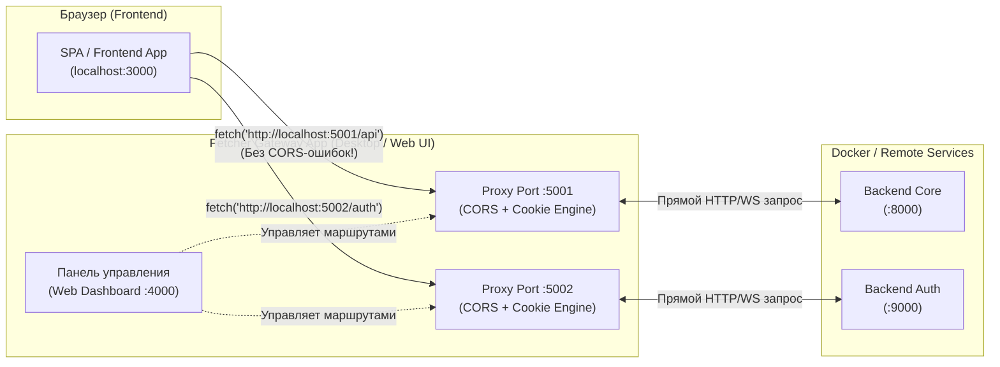

# Концепция и архитектура решения: Dev API Proxy Gateway (Fetcher)

## 1. Анализ проблемы

### Исходная ситуация
* Фронтенд и бэкенд(ы) запущены в разных Docker-контейнерах или на разных хостах/портах (например, фронтенд на `http://localhost:3000`, бэкенд на `http://localhost:8000` или внутри Docker `http://api-service:8080`).
* **CORS ошибки**: Браузер блокирует запросы из-за отсутствия или некорректных заголовков `Access-Control-Allow-*`, сбоев preflight-запросов (`OPTIONS`).
* **Проблемы с Cookie и авторизацией**:
  * Заголовок `Set-Cookie` от бэкенда отклоняется браузером, если не совпадает домен (`Domain`), протокол (`Secure` при HTTP в dev-режиме) или политика `SameSite` (`Strict`/`Lax`/`None`).
  * Флаг `credentials: 'include'` требует строгого совпадения `Access-Control-Allow-Origin` (нельзя `*`) и наличия `Access-Control-Allow-Credentials: true`.
* Доработка каждого бэкенда под CORS в dev-окружении часто неудобна, невозможна (сторонние сервисы / чужие контейнеры) или небезопасна для прод-конфигов.

---

## 2. Идея решения

Создать легковесное приложение-шлюз (**Dev API Proxy / Fetcher Gateway**), которое выступает управляемым умным прокси между фронтендом и бэкендами.

### Как это решает проблему:
1. Пользователь через красивый и удобный интерфейс (Dashboard) добавляет адрес реального бэкенда (например, `http://localhost:8000` или `http://backend-container:8080`).
2. Приложение выделяет виртуальный адрес с локальным портом (например, `http://localhost:5001`).
3. Фронтенд обращается к `http://localhost:5001`.
4. Прокси пересылает запрос на реальный бэкенд, а в ответ:
   * **Автоматически гасит CORS**: перехватывает preflight `OPTIONS` (отвечает `200/204 OK`), динамически подставляет в `Access-Control-Allow-Origin` источник запроса (Origin фронтенда), выставляет `Access-Control-Allow-Credentials: true` и разрешает все заголовки и методы.
   * **Модифицирует Cookie (`Set-Cookie`)**: убирает флаг `Secure` (если работаем по HTTP), переписывает или удаляет директиву `Domain` (чтобы cookie привязались к `localhost`), корректирует `SameSite`.
   * **Проксирует WebSocket**: поддерживает `Upgrade` запросы для сокетов.
   * **Логирует трафик в реальном времени**: даёт возможность инспектировать запросы, заголовки и ответы прямо в интерфейсе.



---

## 3. Режимы работы прокси

Мы поддержим два удобных режима маршрутизации:

1. **Режим выделенных портов (Dedicated Ports) — Основной**:
   * Для каждого добавленного бэкенда выделяется отдельный локальный порт (`localhost:5001`, `localhost:5002`...).
   * **Плюс**: фронтенду не нужно менять пути (`/api/...`), достаточно просто сменить базовый URL в `.env` (например, `VITE_API_URL=http://localhost:5001`).
2. **Режим единого шлюза (Single Gateway / Path Prefix)**:
   * Все запросы идут на один порт через префикс (например, `http://localhost:5000/proxy/auth/...` или по заголовку).
   * **Плюс**: нужен всего один открытый порт.

---

## 4. Ключевой функционал приложения

### 4.1. Умный CORS Resolver
* Автоматический перехват preflight-запросов `OPTIONS` с мгновенным возвратом `204 No Content` / `200 OK`.
* Зеркалирование входящего заголовка `Origin` в `Access-Control-Allow-Origin` (позволяет одновременно работать и `withCredentials: true`, и запросам с любого домена/порта фронтенда).
* Автоматическая генерация:
  * `Access-Control-Allow-Credentials: true`
  * `Access-Control-Allow-Methods: GET, POST, PUT, DELETE, PATCH, OPTIONS, HEAD`
  * `Access-Control-Allow-Headers: *` (или эхо запрошенных `Access-Control-Request-Headers`)
  * `Access-Control-Expose-Headers: *`

### 4.2. Cookie & Header Sanitizer (Трансформация Cookie)
* **Domain Rewriting**: удаление атрибута `Domain=...` или замена на `Domain=localhost`, чтобы браузер не блокировал cookie от другого домена.
* **Secure Flag**: снятие флага `Secure`, если разработка идёт по обычному HTTP.
* **SameSite Relaxation**: автоматическая замена `SameSite=Strict` на `SameSite=Lax` или `SameSite=None` при необходимости.
* **Host Header**: корректная передача оригинального или целевого `Host` заголовка (`changeOrigin: true`).

### 4.3. UI / Панель управления (Modern Web UI / Dashboard)
* Современный стеклянный интерфейс (Dark Mode, неоновые акценты, быстрый отклик).
* **Список прокси-маршрутов**:
  * Название бэкенда (например, "Auth Service", "Billing API").
  * Целевой URL (`http://auth-backend:8080`).
  * Сгенерированный прокси-порт (`http://localhost:5001`) с кнопкой «Скопировать в буфер».
  * Статус активности (Toggle включить/выключить проксирование на лету).
  * Настройки CORS/Cookie (чекбоксы для тонкой настройки при необходимости).
* **Live Traffic Inspector (Инспектор запросов)**:
  * Список проходящих запросов в реальном времени (Метод, Путь, Статус, Время ответа).
  * Просмотр Request/Response Headers, тела запроса и ответа.
  * Индикация того, какие заголовки CORS/Cookie были изменены прокси.
* **Сохранение конфигурации**:
  * Автосохранение всех настроек в `config.json` (при перезапуске сервиса ничего не теряется).

### 4.4. Дополнительные возможности
* Поддержка WebSocket (стримы, чаты, сокеты).
* Быстрый генератор `.env` сниппетов (нажал кнопку — скопировал строчку для своего `.env` фронтенда).
* Проверка доступности целевого бэкенда (Health check пинг).

---

## 5. Предлагаемый стек технологий

* **Backend / Proxy Engine**:
  * **Node.js + Express / Fastify + `http-proxy-middleware`** (или `http-proxy`).
  * *Почему*: Максимальная надежность для проксирования стримов, чанков, сокетов, нулевые проблемы с кроссплатформенностью (Windows/Linux/macOS), легкий запуск одной командой `npm start` или сборка в единый бинарник/exe через `pkg`/`nexe`.
* **Frontend Dashboard**:
  * **React + Vite + TailwindCSS / Vanilla CSS** с кастомной дизайн-системой (тёмная тема, анимации, карточки статусов).
  * Подключение к бэкенду через Server-Sent Events (SSE) или WebSocket для отображения логов в реальном времени.
* **Упаковка / Дистрибуция**:
  * Возможность запуска как обычного локального сервера `npm run dev` / `npm start`.
  * Возможность упаковки в Docker-контейнер для включения в `docker-compose.yml` проекта.
  * Возможность запуска в виде настольного приложения (через Electron или лёгкий веб-интерфейс в браузере `http://localhost:4000`).

---

## 6. План реализации

| Этап | Задача | Результат |
| :--- | :--- | :--- |
| **Этап 1** | Архитектура ядра прокси (Proxy Engine) | Сервер управления + динамическое создание и уничтожение HTTP/WS прокси-серверов на свободных портах. |
| **Этап 2** | Реализация CORS & Cookie Rewrite Engine | Модуль перехвата и модификации заголовков (OPTIONS, Origin reflection, Cookie Domain/Secure/SameSite strip). |
| **Этап 3** | Хранилище настроек и API управления | REST/WebSocket API для добавления, редактирования, включения/выключения маршрутов с сохранением в JSON. |
| **Этап 4** | Разработка современного Dashboard UI | Красивый интерфейс: форма добавления API, карточки маршрутов, кнопка копирования, быстрый статус. |
| **Этап 5** | Live Traffic Inspector | Логирование запросов в UI в реальном времени с подсветкой статусов и деталями заголовков. |
| **Этап 6** | Тестирование и документация | Проверка на реальных сценариях с кросс-доменными запросами, cookie и Docker. Подготовка README с примерами. |

---

## 7. Пример использования в проекте

1. Запускается приложение `Fetcher` (доступно на `http://localhost:4000`).
2. В интерфейсе нажимаем **"Add Backend"**:
   * Name: `Users Backend`
   * Target URL: `http://localhost:8000` (или `http://backend-service:8000` в docker сети)
3. Приложение выделяет порт: `http://localhost:5001`.
4. В коде фронтенда указываем:
   ```env
   VITE_API_URL=http://localhost:5001
   ```
5. Фронтенд шлет запросы на `http://localhost:5001`. Ошибки CORS и блокировки Cookie полностью исчезают, а в панели Fetcher виден весь лог запросов.
